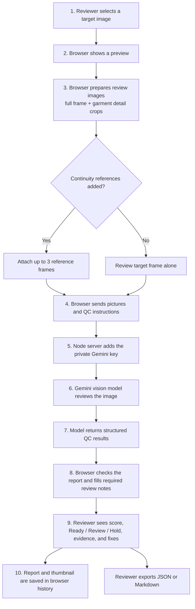
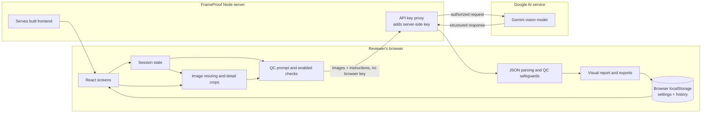
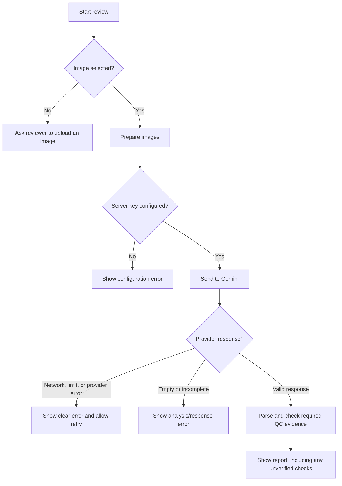

# FrameProof: end-to-end architecture

This guide explains how a review travels through FrameProof, from image selection to the final report. It starts with a plain-language flowsheet, then describes the browser, backend, and AI model roles.

## The short version

**Your browser prepares the pictures and displays the report. A small Node server keeps the AI key private and forwards the review request. Gemini examines the pictures and returns a structured report. FrameProof checks and saves the report in your browser.**

The Node server does not itself understand or judge the image. The vision model performs the visual review.

## Plain-language flowsheet

If the server has no Gemini key, it returns a configuration error. If Gemini or the network fails, FrameProof shows an error so the reviewer can retry. If the model response is incomplete, report checks can mark the relevant area as unverified instead of silently calling it a pass.

## What happens at each step

1. **Choose the image.** The browser opens the selected still and displays its name and dimensions. It keeps the original image in the current page session for analysis.
2. **Choose checks.** Settings select which visual areas the AI should review. The defaults cover framing, identity, materials, anatomy, costume and textile continuity, waist belt, janeu, ornaments, props, environment, lighting, image artifacts, and reference continuity.
3. **Prepare the request.** The browser resizes the main image for the model. When garment-related checks are enabled, it also prepares a garment context crop and a magnified torso/waist crop. These crops are from the same frame; they are not extra camera views. The reviewer can optionally attach up to three approved reference frames.
4. **Send it through the backend.** The browser sends the image data and review instructions to the app's `/api/gemini` route. The browser does not add or store the Gemini API key.
5. **Forward securely.** The Node server reads `GEMINI_API_KEY` from its environment and forwards the request to Google's Gemini API with the key. The server acts as a protected doorway; it does not run the QC rules or save uploaded images.
6. **Review with AI.** The prompt tells the vision model which QC checks are active and how to report visible evidence, locations, confidence, severity, and corrections. It asks for explicit textile path traces so a generic “the design is consistent” statement is not enough to pass. Belt fit and janeu alignment are separate checks.
7. **Validate the response.** The browser parses the model's JSON, normalizes its decision, and checks required report details. For example, if a visible garment has no complete textile path trace, FrameProof marks that check for review. If a trace reports a design break but has no finding, FrameProof adds one from the trace.
8. **Show and save.** The browser displays the report. Settings and run history are stored in browser `localStorage`; history is limited to 30 reports and includes a target thumbnail. The reference images themselves are not added to the history record.
9. **Export.** The reviewer can download the report as JSON data or Markdown.

## System flowsheet

## What the backend does

FrameProof's backend is deliberately small:

- In **local development**, Vite serves the frontend and forwards `/api/gemini` requests to Google. Vite reads the local environment configuration.
- In **production**, `server.cjs` serves the built `dist/` website and forwards `/api/gemini` requests. It reads the key from the server environment (or local `.env.local` for local runs).
- The proxy adds the Gemini key to the upstream request and passes the response back. It does not interpret the image, create the QC report, or use a database.
- The server also has OpenRouter and OpenCode proxy routes, but the current Analyze screen pins image reviews to Gemini. The presence of those routes does not mean they are active in this workflow.

## Where information goes

| Information | During a review | Saved by FrameProof |
|---|---|---|
| Target image | Prepared in the browser and sent through the server proxy to Gemini | Original stays in the current page session; a resized thumbnail is stored with local history |
| Garment crops | Made in the browser from the target and sent with it | Not stored as separate history images |
| Reference frames | Optional; sent with the target for visual comparison | Filenames appear in the report; reference image files are not added to history |
| Gemini API key | Read by the server and added to the outgoing provider request | Not sent to browser storage or bundled into frontend code |
| Settings | Used in the browser to choose checks and response options | Saved in browser `localStorage`; API-key field is cleared before saving |
| QC report | Returned from Gemini, parsed, and shown in the browser | Saved with local history in browser `localStorage` |

This app has no application database for images or reports. However, images are sent to Gemini for analysis, and the browser keeps report history and thumbnails locally. Provider-side handling is governed by the provider's current terms and settings.

## Error paths

## Important limits

- FrameProof is a visual assistant, not a pixel-measuring or deterministic defect detector. The model may still miss a subtle issue; structured traces and required-check safeguards reduce unsupported passes but do not guarantee perfect detection.
- One still cannot prove motion, audio, editing continuity, or the appearance of surfaces outside the frame. Reference images only support comparison of the views and details they show.
- A `Ready` decision means the model did not report a material issue in the available evidence. It is not a guarantee that every production requirement has been met.

## Technical source map

- `src/components/AnalyzePanel.tsx`: image preparation, request lifecycle, model call, report/history handoff.
- `src/lib/image.ts`: image resizing and garment crop generation.
- `src/lib/llm.ts`: prompt, Gemini request/response handling, parsing, and report safeguards.
- `src/lib/types.ts`: QC domains and report types.
- `src/lib/store.ts`: browser state, settings migration, and local history.
- `src/components/ReportPanel.tsx`: report presentation and export.
- `vite.config.ts`: development/preview proxies.
- `server.cjs`: production static server and protected provider proxy.
