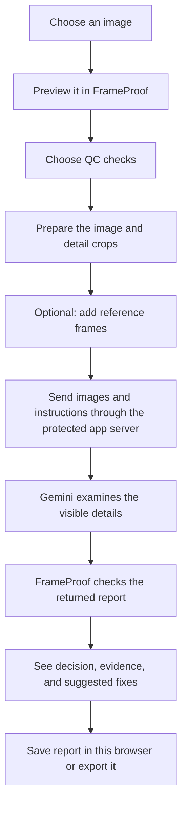

# How FrameProof works: process and technology guide

This is a plain-language companion to the [architecture flowsheet](architecture-overview.md). It explains what happens in one review, what each technology does, and what the percentages in this guide mean.

## One review, from start to finish

### What each step means

1. **Choose and preview:** the image stays in the browser while the review is being prepared.
2. **Choose checks:** the reviewer selects areas such as anatomy, skin, clothing, textile continuity, belt fit, janeu alignment, props, and lighting.
3. **Prepare detail:** the browser makes a resized full image. Garment checks also make a garment context crop and a magnified torso/waist crop, so the model receives more detail around borders, belts, and drape intersections.
4. **Add references if useful:** up to three approved images can be included to compare stable character, costume, or prop design. They are treated as references, not extra angles of the target.
5. **Send for vision review:** the browser sends the images and selected checks to the FrameProof server route. The server adds the private Gemini key and forwards the request to Google's Gemini service.
6. **Check the response:** Gemini returns a structured report. FrameProof parses it, checks required evidence such as garment path traces, and marks unsupported or incomplete reviews for attention.
7. **Review and keep results:** FrameProof shows the score, Ready/Review/Hold decision, per-check notes, visible evidence, and fixes. The report and a thumbnail go to this browser's history; the report can also be exported.

## Technology used and what it does

| Technology | Where it is used | Purpose in everyday terms |
|---|---|---|
| **React** | Browser interface | Builds the upload, settings, analysis, report, and history screens. |
| **TypeScript** | Browser app and Vite configuration | Describes the shape of reports and settings, and catches many wiring mistakes while building the app. |
| **Zustand** | Browser app state | Holds the current image, selected checks, progress, report, and history while the app is open. |
| **Browser Canvas API** | Image preparation | Resizes images and creates focused garment/waist crops before sending them for analysis. |
| **Gemini vision API** | External AI service | Looks at the supplied images and returns the requested visual QC report. |
| **Node.js built-in HTTP/HTTPS** | Production backend (`server.cjs`) | Serves the built website and forwards AI requests while adding the private API key. The backend does not judge images. |
| **Vite** | Development and build tooling | Runs the local frontend during development and bundles the app for deployment. Its development proxy forwards Gemini requests without putting the key in the browser. |
| **Browser `localStorage`** | This browser only | Remembers settings and up to 30 report-history entries, including a target thumbnail. It is not a remote database. |
| **CSS** | Browser interface | Controls layout, colors, responsive behavior, and animation. |
| **File Saver** | Report screen | Downloads JSON and Markdown report files to the user's device. |

## Percentage breakdown

These percentages describe the **share of non-empty lines in the tracked runtime source files**, grouped by file type. They are a snapshot of code size, measured in the current project checkout. They do not describe time spent, system importance, AI accuracy, or the percentage contribution to a QC score.

| Source group | Non-empty lines | Share |
|---|---:|---:|
| TypeScript / TSX (browser app, report logic, image preparation, Vite config) | 2,063 | 64.47% |
| CSS (visual design and layout) | 986 | 30.81% |
| JavaScript (Node server/proxy) | 133 | 4.16% |
| HTML (page entry point) | 18 | 0.56% |
| **Total counted** | **3,200** | **100.00%** |

This count includes text source in `src/`, `server.cjs`, `vite.config.ts`, and `index.html`. It excludes images, generated build output, dependencies, lockfiles, and documentation. Adding a small amount of text code changes these percentages; use them as a size snapshot, not a product-performance metric.

## What does the QC score percentage mean?

The model returns an overall score and scores for individual checks on a 0–100 scale. These are **model-assessed quality scores**, not the code percentages above. FrameProof does not currently apply a fixed rule such as “textile continuity is 20% of the final score.” The model proposes the scores and decision; the app adds safeguards that can lower the score or change a check to Review when required evidence is missing or incomplete.

`Ready`, `Review`, and `Hold` summarize the returned evidence. They are not a guarantee that every defect was found. A single image also cannot prove motion, sound, editing continuity, or what is hidden outside the frame.

## What is stored and what is sent

- The target image, its detail crops, and optional reference frames are sent to Gemini for the requested review.
- The Gemini key is kept on the server and added to the provider request there; it is not saved in browser storage.
- FrameProof stores settings and review history in the browser's `localStorage`. History contains the report and a target thumbnail, not the original reference image files.
- FrameProof has no application database for these reviews. Provider-side handling follows Google's current service terms and account settings.

## Local and production setup

- **Local development:** `npm run dev` starts Vite. The Vite proxy forwards `/api/gemini` requests using the local server environment configuration.
- **Production:** `npm run build` creates the website files in `dist/`; `npm start` runs the Node server, which serves those files and proxies Gemini requests. `GEMINI_API_KEY` must be configured in the server environment.

The active image-review screen currently uses Gemini. Other proxy routes in the code do not mean another provider is active in this review flow.
